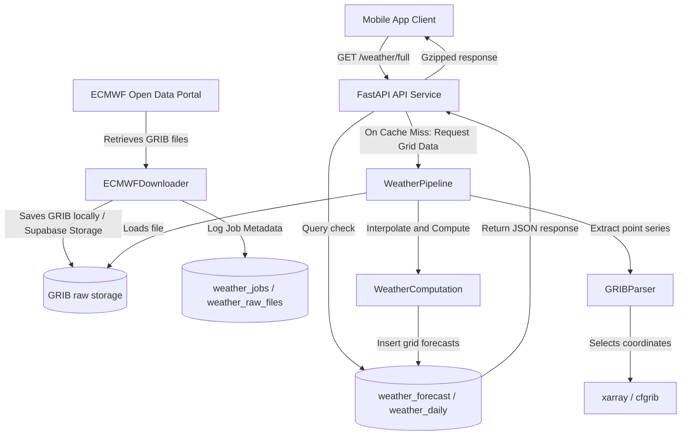
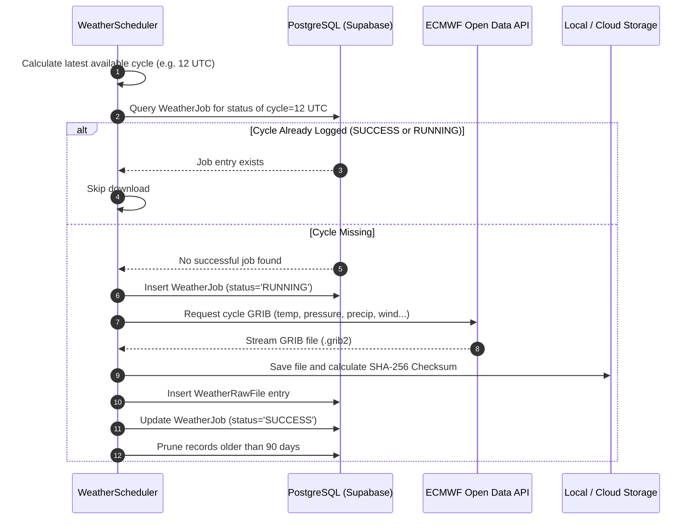
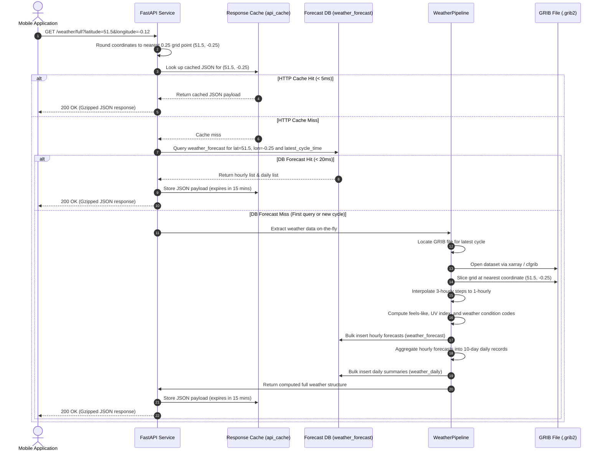

# System Architecture & Design

This document details the software architecture, database design, and workflow sequence diagrams for the ECMWF Weather Platform.

---

## 1. System Architecture Diagram

---

## 2. Sequence Diagrams

### 2.1 Periodical Ingestion Workflow (6-Hourly Scheduler)

The scheduler checks every 30 minutes for new ECMWF forecast cycles (00, 06, 12, 18 UTC) and downloads them.

### 2.2 On-Demand Mobile API Fetch Workflow (Cache Hit vs Cache Miss)

Mobile clients request the weather forecast for arbitrary latitudes and longitudes. 

---

## 3. Database Schema

### 3.1 `weather_jobs`
Tracks GRIB download jobs.
- `id` (UUID): Primary key.
- `cycle_time` (timestamp with time zone): The UTC start time of the forecast run (00, 06, 12, or 18 UTC).
- `status` (varchar): Ingestion status (`PENDING`, `RUNNING`, `SUCCESS`, `FAILED`).
- `error_message` (text): Stacktrace / description if job failed.

### 3.2 `weather_raw_files`
Tracks downloaded physical GRIB files.
- `id` (UUID): Primary key.
- `job_id` (UUID): Reference to the creator job.
- `cycle_time` (timestamp with time zone).
- `file_path` (varchar): Absolute location path of GRIB file.
- `file_size` (bigint): File size in bytes.
- `checksum` (varchar): SHA-256 hash.

### 3.3 `weather_forecast` (Partitioned table)
Hourly forecast coordinates. Partitioned by range on `forecast_time`.
- `latitude` (numeric): Point latitude.
- `longitude` (numeric): Point longitude.
- `forecast_time` (timestamp with time zone): Target hour for the forecast.
- `cycle_time` (timestamp with time zone): The ECMWF cycle this forecast was generated from.
- `temperature` (numeric): °C.
- `feels_like` (numeric): °C.
- `precipitation` (numeric): mm.
- `humidity` (numeric): %.
- `pressure` (numeric): hPa.
- `cloud_cover` (numeric): %.
- `wind_speed` (numeric): m/s.
- `wind_direction` (numeric): Degrees.
- `dew_point` (numeric): °C.
- `uv_index` (numeric): 0 to 15.
- `visibility` (numeric): Meters.
- `weather_code` (varchar): `CLEAR`, `PARTLY_CLOUDY`, `CLOUDY`, `RAIN`, `THUNDER`, `SNOW`, `FOG`, `WINDY`.

### 3.4 `weather_daily`
10-day summary aggregate forecasts.
- `latitude` (numeric).
- `longitude` (numeric).
- `forecast_date` (date).
- `cycle_time` (timestamp with time zone).
- `temp_min` (numeric): °C.
- `temp_max` (numeric): °C.
- `precipitation` (numeric): Total rainfall for the day in mm.
- `humidity_avg` (numeric): %.
- `wind_speed_max` (numeric): m/s.
- `weather_code` (varchar): Dominant weather condition.
